# AI Stack with Claude Code and PydanticAI

Architecture choices, flowcharts, explanations, and alternatives for Python AI applications.

**Markdown edition:** 26 October 2026.  
**Official documentation last checked:** 25 October 2026.

**Recommendation:** use Claude Code to develop and maintain the software. Run the application through an importable Python workflow with PydanticAI for model calls, tools and typed results. Start with one approved model, versioned prompts, automated evaluation and tracing. Use a CLI, an existing worker, or your existing application as the entry point.

**Scope:** internal AI applications, extraction, research assistance, and automation. The choices below are architectural recommendations, rather than a benchmark ranking. Storage, retrieval, durable execution, a UI, and Kubernetes are conditional additions.

The diagrams use Mermaid. A Markdown viewer with Mermaid support renders them as flowcharts; a plain text editor shows the editable diagram definitions. Each component's diagram appears before its explanation, usage conditions, rationale and alternatives.

## Contents

- [Overall architecture](#overall-architecture)
- [Recommended components and adoption triggers](#recommended-components-and-adoption-triggers)
- [The 15 components](#the-15-components)
- [Build the stack in four stages](#build-the-stack-in-four-stages)
- [Restricted networks and GPU placement](#restricted-networks-and-gpu-placement)
- [Example request paths and ownership](#example-request-paths-and-ownership)
- [Suggested code organization](#suggested-code-organization)
- [Official documentation](#official-documentation)

## Overall architecture


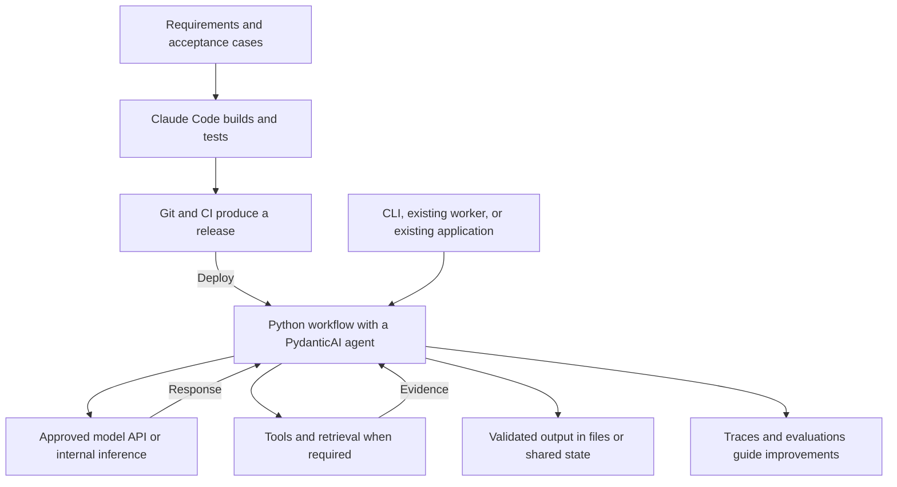


**Reading the architecture:** the development path moves from requirements through Claude Code into a reviewed release. The running application accepts a task through a CLI, worker or existing integration and invokes the Python workflow. PydanticAI coordinates the model-driven portion. Tool access, retrieval, state and telemetry serve separate needs. Claude Code is available again when you improve the application; it need not run for every user task. [ref 1][ref-1], [ref 11][ref-11]

**Smallest useful stack:** Claude Code + Git + Python/uv + Pydantic + PydanticAI + one approved model + JSON files + pytest/Pydantic Evals + tracing.

**Execution boundary:** the workflow is an ordinary Python function or async function that accepts validated input and dependencies and returns a typed result. The CLI and worker are adapters around it. Model provider APIs remain necessary when the model is accessed over HTTP; they are separate from the application's entry point.

## Recommended components and adoption triggers

| Layer | Recommended starting point | Add or change when |
| --- | --- | --- |
| Development | Claude Code, Git, `CLAUDE.md` | Repeated tasks justify skills or isolated development workers |
| Environment | Python, uv, Ruff, pytest, one type checker | Use an existing scientific environment if required |
| Entry point | CLI or existing worker calling Python | Add an optional interface for review or user interaction |
| Contracts | Pydantic and prompts in Git | Team prompt workflows need a registry |
| Agent runtime | One PydanticAI agent plus Python workflow | Complex branching warrants a typed graph |
| Models | One approved provider API | Internal hosting or centralized routing is required |
| Tools | Typed Python functions and HTTPX | A reusable approved MCP server is available |
| Retrieval | Use supplied context | Corpus search needs lexical or vector retrieval |
| Storage | JSON files for local processing | Shared state needs a database; large artifacts need object storage |
| Background jobs | Direct call; existing queue when needed | Recovery between steps or long waits justify durable execution |
| Observability | OpenTelemetry and approved backend | Logfire is a convenient integrated option |
| Evaluation | pytest plus Pydantic Evals | Grow cases and metrics from observed failures |
| Deployment | Existing platform; Docker for packaging | Kubernetes is supported or operationally justified |
| Identity and policy | Existing identity and secrets services | Shared users and actions need scoped enforcement |
| Specialization | One agent and bounded compute tools | Measured improvements justify multiple agents |

## The 15 components


### 1 Claude Code and project instructions

Used while developing, reviewing and maintaining the software.


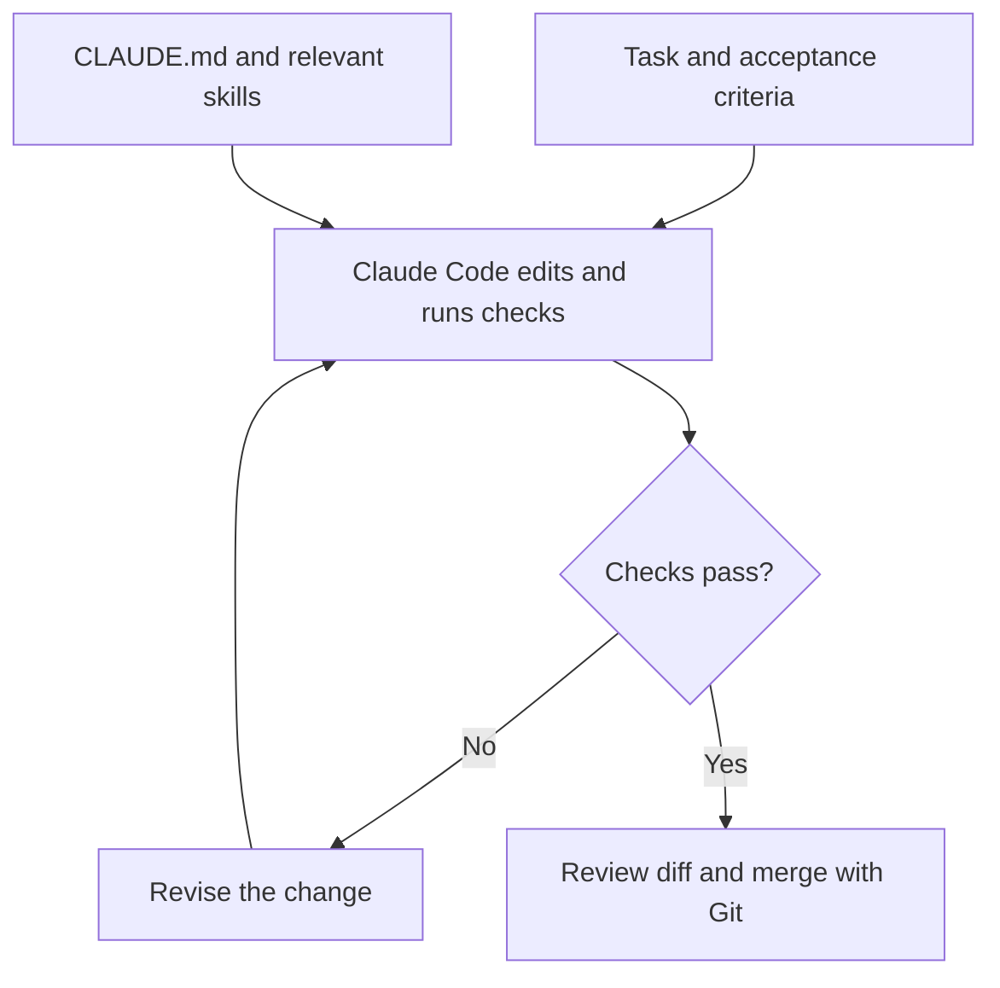


**Reading the flowchart**

A concrete task and repository context guide Claude Code. It edits code, runs the available tools and repeats when checks fail. A reviewed Git change becomes the input to deployment. Claude Code can read files, modify them and execute commands. [ref 1][ref-1]


**Why use this piece**

Use it as the development assistant across this entire stack. Keep **CLAUDE.md** short: project purpose, architecture, exact test commands, and links to deeper documentation. Put a repeatable task such as reviewing a new tool in a skill. Use command hooks for mechanical checks; keep required release checks in CI as well. [ref 2][ref-2], [ref 3][ref-3], [ref 4][ref-4]


**When to use it**

Use a subagent when a development task benefits from its own context or an independently reviewable result. Give separate tasks clear file ownership. Start with one coding session and add parallel work when it addresses an observed bottleneck. Project instructions are model context; permissions and operating-system controls enforce access. [ref 2][ref-2], [ref 3][ref-3]


**Alternatives:** Codex or an IDE coding assistant if that fits the team; Aider when provider flexibility or local model access matters. These replace or complement the coding assistant. They do not require changing the application agent framework. [ref 32][ref-32]


**Starting choice:** Claude Code in your existing editor, Git, a concise CLAUDE.md, and only the skills you repeatedly use.

### 2 Python environment and quality tools

Used whenever someone installs dependencies, edits code or creates a release.


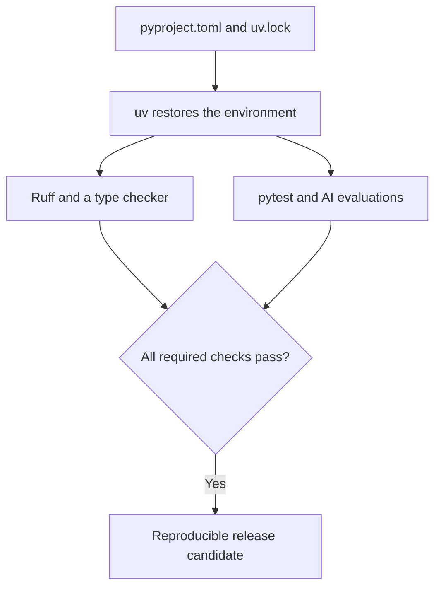


**Reading the flowchart**

The committed dependency files define the environment. uv creates or synchronizes it. Static checks and tests exercise different failure modes before the release candidate is accepted. A failed check returns the change to development. [ref 5][ref-5], [ref 6][ref-6], [ref 7][ref-7]


**Why use this piece**

Use **uv** for environment and dependency management, **Ruff** for linting and formatting, **pytest** for application tests, and one type checker such as Pyright or mypy. Pydantic validates values at runtime; static type checking catches incompatible code paths before execution. Pin the Python version and commit the lockfile.


**When to use it**

This layer belongs in the first prototype. It becomes especially useful with AI-written changes because fast, repeatable feedback keeps revisions grounded in executable evidence. Run the same commands locally and in CI. Use deterministic test doubles in the fast suite; keep paid model evaluation as a separate controlled job.


**Alternatives:** pip plus venv and a locked dependency file for a simple established project; Poetry for an existing Poetry workflow; conda when native scientific dependencies dominate. Black plus Flake8 can remain in a mature repository. Avoid switching tools without a practical benefit.


**Starting choice:** uv, Ruff, pytest and one type checker. Each has a distinct job.

### 3 Entry points and optional user interface

Used to run the same Python workflow from a command, an existing worker, or an optional interface.


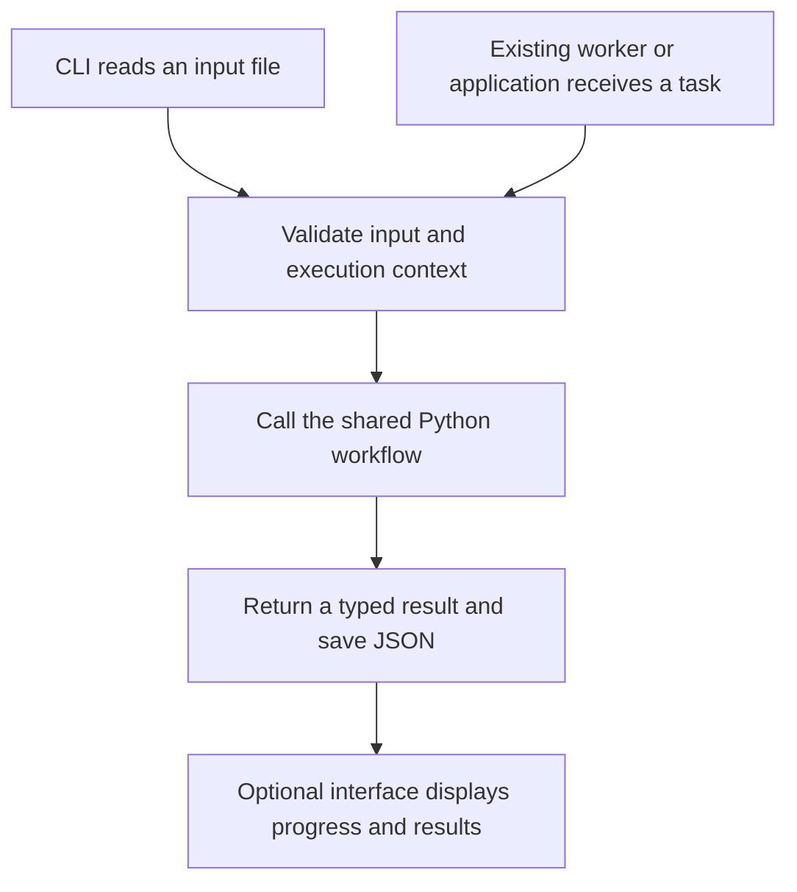


**Reading the flowchart**

A CLI loads an input file, or an existing worker passes a job to the application. The entry point validates the input and execution context, then calls the same ordinary Python workflow. The workflow returns its typed result and saves the output. An optional interface displays the result without owning the AI logic.


**Why use this piece**

Direct Python calls fit file processing, existing queue consumers, scheduled jobs, notebooks, and applications that already have an integration layer. Keep the workflow importable so a command, a worker and tests can all invoke it. A separate web server is unnecessary for this design.


**When to use it**

Start with a CLI for local file processing or connect the workflow to the worker you already have. Add an interface when people need upload, inspection, correction or approval. Streamlit is an optional Python interface for internal review; its display code can call the shared workflow. Long jobs should execute in a worker whose lifetime is independent of the interface. [ref 8][ref-8]


**Alternatives:** an imported Python function, a scheduled script, a notebook for exploration, an existing job runner, or Gradio for a demonstration interface. If an existing frontend needs integration, use the application boundary your environment already supports.


**Starting choice:** a CLI or existing worker calling an importable Python workflow; add a UI only when useful.

### 4 Pydantic contracts and versioned prompts

Used before a model call and before a generated result is accepted or saved.


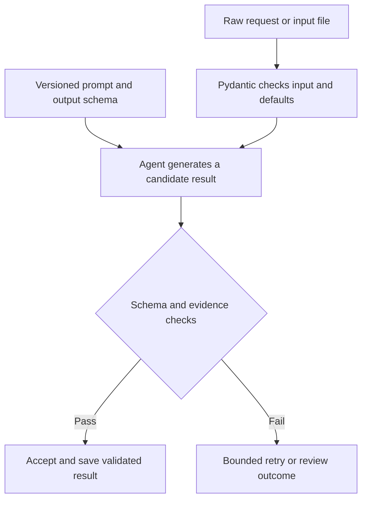


**Reading the flowchart**

The input contract determines what the application accepts. The prompt describes the task; the output contract defines its result shape. PydanticAI validates structured output with Pydantic. Application checks then test evidence links and domain rules before saving. [ref 9][ref-9]


**Why use this piece**

Use Pydantic models for request, tool argument and result contracts. Keep prompts under version control beside the schemas and evaluation cases. For extraction, define missing values explicitly, preserve source identifiers, and make extra-input handling a deliberate choice. A schema checks structure; factual correctness requires evidence checks and evaluation.


**When to use it**

This layer is essential whenever another program consumes the answer. Recheck it after changing a prompt, schema or model. Persist schema version, prompt version, model identifier and source references with the result so a later reviewer can understand how it was produced.


**Alternatives:** dataclasses, TypedDict or JSON Schema where they fit existing contracts. A provider native structured-output API can enforce supported schema constraints, but the application still needs validation and error handling. Add a separate prompt-management service only when team workflows justify it.


**Starting choice:** Pydantic models plus prompts in Git; validate source references before writing JSON.

### 5 PydanticAI and the application workflow

Used for each model-driven task, including tool selection and typed final output.


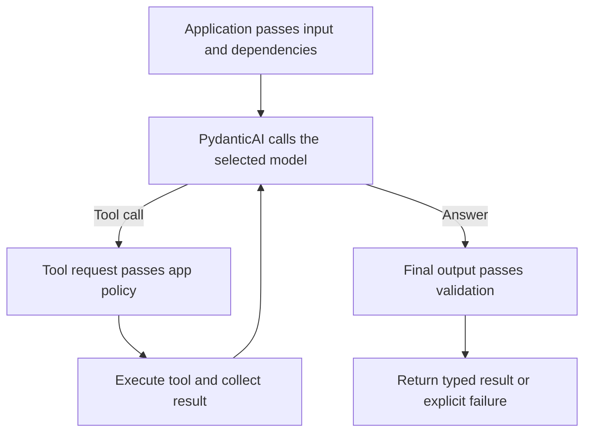


**Reading the flowchart**

PydanticAI sends context to a model. When the model requests a tool, the application checks the request and executes an allowed function. The tool result feeds the next model turn. A final response is validated into the declared output type. Retries and errors have bounded paths. [ref 9][ref-9], [ref 10][ref-10]


**Why use this piece**

This is the central application AI framework: typed results, tool definitions, provider adapters, dependency injection and instrumentation fit a Python codebase. Inject authenticated user context and service clients through dependencies rather than asking the model to supply them. PydanticAI runs inside your process. [ref 11][ref-11], [ref 15][ref-15]


**When to use it**

Use a single agent for extraction, question answering or a tool-assisted task. Keep known business steps in Python: load, split if necessary, run, combine, verify and save. Add a typed graph when branching state becomes difficult to follow. Use request and tool-call limits alongside timeouts; cost estimates depend on available usage and pricing information. [ref 10][ref-10]


**Alternatives:** a direct provider SDK for one very simple call; LangGraph for a graph-centered application with complex state transitions. A retrieval-focused library can complement selected tools. Choose one owner of the core agent loop and make integration boundaries explicit. [ref 29][ref-29]


**Starting choice:** one PydanticAI agent inside an ordinary Python workflow; no separate agent platform is required.

### 6 Model providers and inference

Used whenever the agent needs generation, embeddings or another model capability.


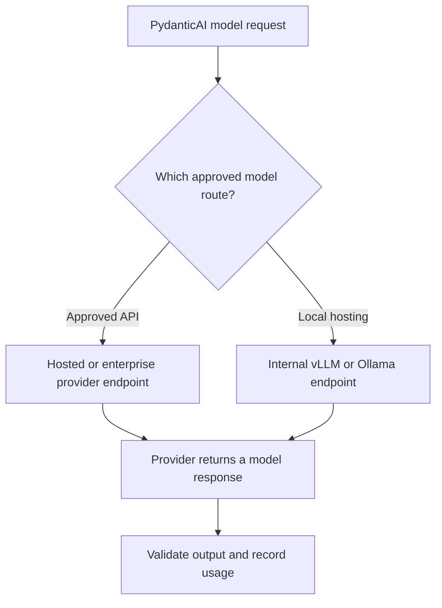


**Reading the flowchart**

The agent uses a configured provider adapter to reach an approved endpoint. The same evaluation dataset tests any proposed model change. PydanticAI supports multiple provider routes, including compatible internal endpoints; features still vary by model and API. [ref 12][ref-12]


**Why use this piece**

Start with **one approved model** that meets your task requirements. Choose it using your own quality, latency, context and cost results. Use **vLLM** as a candidate for shared internal inference, or Ollama for a convenient local setup. Benchmark throughput and memory on the intended hardware. [ref 12][ref-12], [ref 13][ref-13]


**When to use it**

Add a gateway such as an existing enterprise gateway or LiteLLM when multiple applications need shared routing, credentials, quotas or audit controls. A single application calling one provider can use the direct adapter. Gateways, model servers and agent frameworks solve separate problems. [ref 33][ref-33]


**Alternatives:** an approved managed model service when operations simplicity matters; llama.cpp or another local server when hardware and model format fit. An internal chat website is usable programmatically only when its operator exposes a supported API. Provider compatibility does not guarantee identical tool calling or structured-output behavior.


**Starting choice:** one direct approved API; add shared inference or a gateway only for a concrete deployment need.

### 7 Python tools HTTPX and MCP

Used when the agent needs data or actions beyond the information already in its input.


```mermaid
flowchart TD
    call["Model proposes a typed tool call"]
    policy["Application checks identity and scope"]
    python["Python function HTTPX or local code"]
    mcp["MCP client approved server tool"]
    result["Validate tool result and record the call"]
    return["Return evidence to the agent"]
    call --> policy
    policy --> python
    policy --> mcp
    python --> result
    mcp --> result
    result --> return
```


**Reading the flowchart**

A model chooses a named capability and supplies arguments. Your code checks permissions, validates arguments and performs the operation. A Python tool can use HTTPX to call an internal REST API. MCP supplies a reusable client-server interface for tools shared across applications. [ref 14][ref-14], [ref 16][ref-16], [ref 17][ref-17]


**Why use this piece**

Start with small Python functions whose inputs and outputs are easy to test. Use HTTPX for async HTTP clients, explicit timeouts and connection reuse. Adopt MCP when an approved server already provides the needed capability or several agent clients need the same tool interface. [ref 14][ref-14]


**When to use it**

Use tools for authoritative lookups, calculations, file processing or approved external actions. Supply user identity and credentials from application dependencies. Check action scope in the tool implementation; a prompt instruction alone is insufficient enforcement. Make repeated writes safe before adding retries.


**Alternatives:** a vendor SDK, a direct database query behind a controlled service, or ordinary Python when no protocol is needed. A Claude Code skill is a reusable instruction bundle. A runtime tool is executable application capability. Design and test each for its own role.


**Starting choice:** typed Python tools plus HTTPX; add a small number of relevant MCP servers when useful.

### 8 Retrieval and document search

Used when answers require finding relevant passages across a larger source collection.


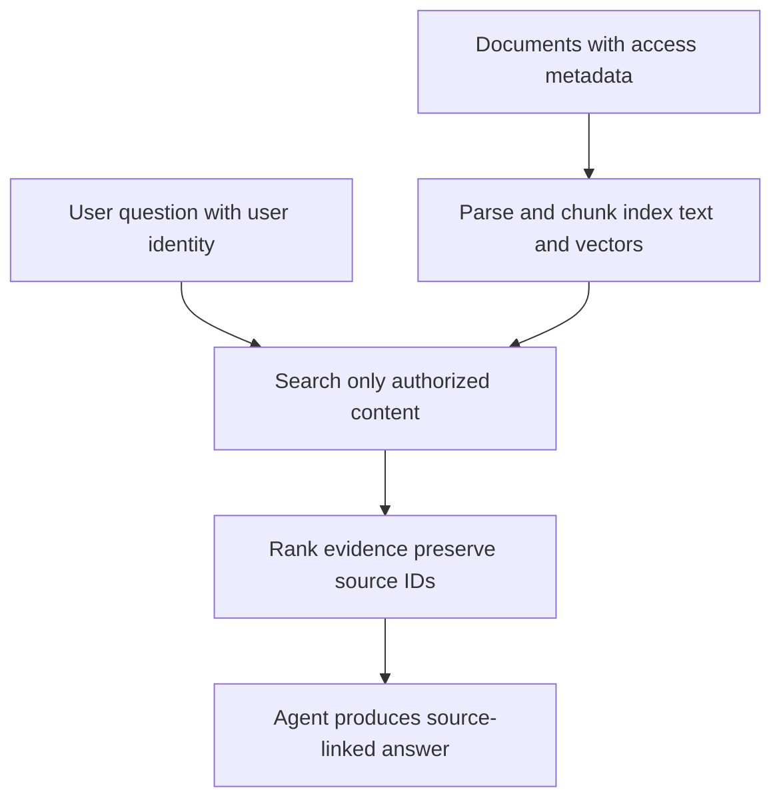


**Reading the flowchart**

Indexing prepares a searchable document collection. At question time, the retriever searches content the user may access, selects evidence and passes it to the agent. The answer retains stable document and passage references. These are separate ingestion and query paths.


**Why use this piece**

Use retrieval augmented generation when the source collection is larger than sensible request context or changes independently of the application. For an initial shared store, consider **PostgreSQL full-text search plus pgvector**. pgvector adds vector similarity search to Postgres; hybrid search can combine lexical and semantic signals. [ref 18][ref-18]


**When to use it**

Skip retrieval for a transcript or document already supplied in full for processing. For long-document summarization, chunk-and-combine processing may be enough. Add retrieval when users need to find evidence across a collection. Measure retrieval recall and answer grounding separately before adding reranking.


**Alternatives:** lexical search alone for exact identifiers; Qdrant for a dedicated vector service; OpenSearch when your organization already operates it. LlamaIndex is worth considering for substantial ingestion and retrieval work. It need not replace PydanticAI as the agent-loop owner. [ref 19][ref-19]


**Starting choice:** use supplied context first; add retrieval and a search store when corpus search is a requirement.

### 9 Results state and artifact storage

Used when a result, conversation or job must remain available after the process exits.


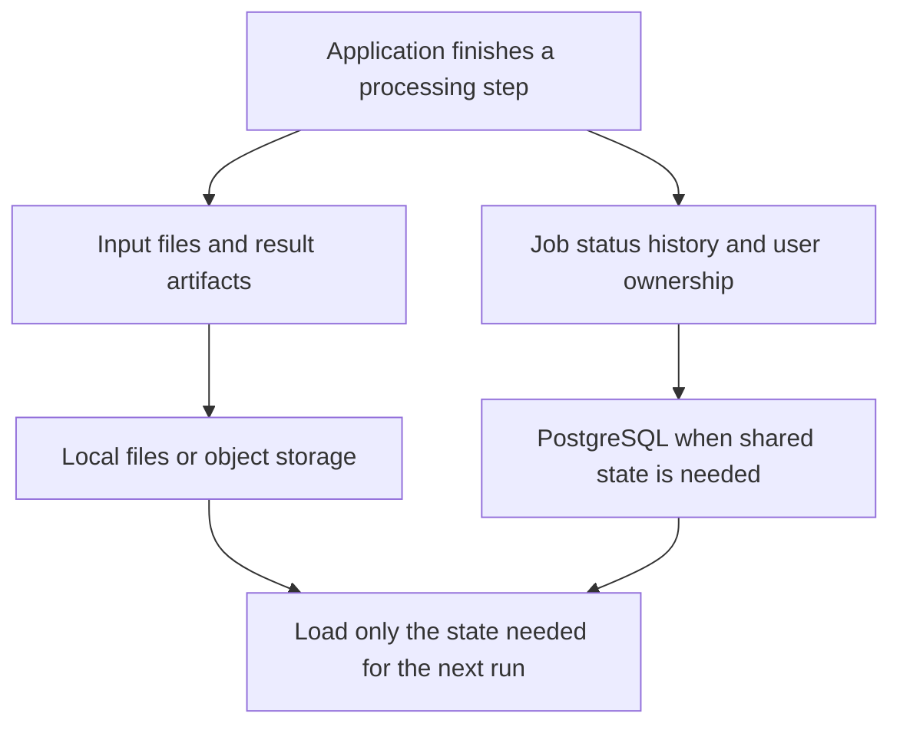


**Reading the flowchart**

Artifacts and application state have different access patterns. Large inputs and output files belong in a file or object store. A shared job table or conversation history may justify a database. The next request loads selected records explicitly rather than relying on a process remaining alive.


**Why use this piece**

For a local file-to-JSON tool, save the validated output using a temporary file and atomic rename on the same filesystem. For a shared service, object storage handles artifacts while PostgreSQL can hold ownership, status and result references. Database adoption should follow concrete state and concurrency needs.


**When to use it**

Persist conversation history only if the product needs continuity, with a defined retention policy and context selection. Workflow checkpoints, conversation history, retrieval indexes and telemetry are distinct records. A plain agent run does not create durable workflow recovery by itself. [ref 11][ref-11], [ref 20][ref-20]


**Alternatives:** SQLite for a local application needing queries; existing enterprise storage for managed services. DuckDB and Parquet are good optional tools for batch analytics over large datasets. Redis can be a cache or coordination component when required, with persistence and eviction configured for that role.


**Starting choice:** files for a local prototype; PostgreSQL plus object storage when shared durable state is necessary.

### 10 Workers queues and durable execution

Used when work must finish independently of its caller or resume after a crash or approval wait.


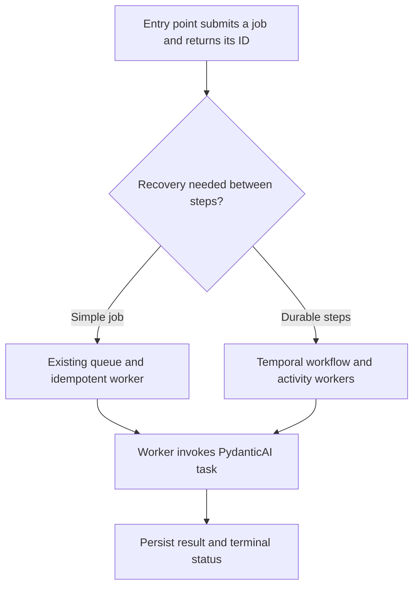


**Reading the flowchart**

A background job runs independently of the CLI, interface or process that submitted it. A simple queue dispatches work to a worker. When individual steps need durable recovery or long waits, a workflow engine records progress and coordinates retries. PydanticAI performs the model-driven task inside that execution. [ref 20][ref-20], [ref 21][ref-21]


**Why use this piece**

Use an existing worker and queue for straightforward jobs. Choose **Temporal** as the default candidate when multi-step recovery, external events or long approvals are real requirements and the team can operate it. Durable execution is provided by the engine and its persistence, rather than by adding an async keyword. [ref 20][ref-20], [ref 21][ref-21]


**When to use it**

Require stable job IDs, explicit job states, cancellation and idempotent side effects. Standard SQS delivery can repeat messages, so a repeated delivery must not create a duplicate external action. Workflow activity retries need the same care. Use an independent execution service for critical long jobs and persist their terminal status. [ref 22][ref-22]


**Alternatives:** DBOS if a PostgreSQL-centered durable approach fits; Prefect for data-oriented workflows; an existing SQS worker if it already meets recovery needs. Choose one durable execution engine for a given agent integration. [ref 20][ref-20]


**Starting choice:** direct execution for short tasks; existing queue next; Temporal when durable workflow recovery is needed.

### 11 OpenTelemetry and observability

Used while debugging, operating and improving every significant AI request.


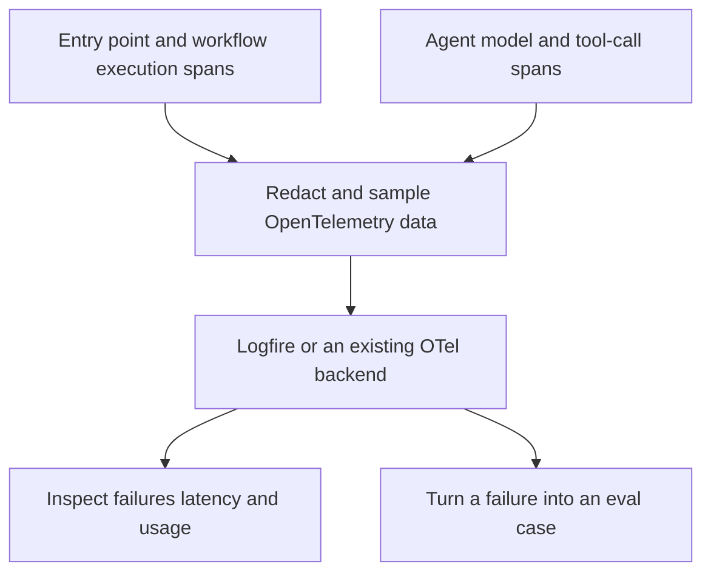


**Reading the flowchart**

A trace connects an incoming task to model calls, tools and output checks. Redaction happens before export. An observability backend makes those spans searchable so you can explain a failure or slow task. Useful failures become evaluation examples. [ref 23][ref-23], [ref 24][ref-24]


**Why use this piece**

Use **OpenTelemetry** as the instrumentation standard. **Pydantic Logfire** is a convenient integrated choice when its deployment and data handling fit. PydanticAI also supports other compatible telemetry backends. Choose an existing organizational platform when that reduces operational burden. [ref 23][ref-23]


**When to use it**

Add basic tracing in the prototype and review it before service deployment. Track end-to-end latency, model time, tool time, retries, error rate, token usage and output-check failures. Store prompt and model version identifiers. Capture source content only when necessary and permitted; redaction must apply before telemetry leaves the process.


**Alternatives:** an existing OTel collector and trace backend; an AI-focused platform such as Langfuse after checking its current integration. Metrics dashboards and traces serve different questions. Log records can help debugging, while persistent product state belongs in the application state layer.


**Starting choice:** OTel instrumentation plus Logfire if approved, otherwise your existing telemetry backend.

### 12 Tests and Pydantic Evals

Used before accepting changes to code, prompts, schemas, retrieval or the selected model.


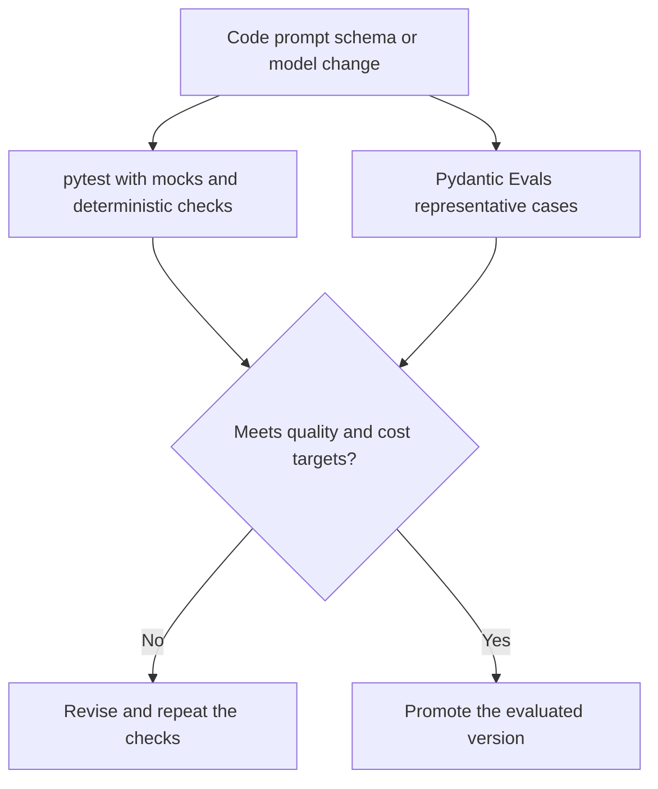


**Reading the flowchart**

Ordinary tests check software behavior. Model evaluations assess the answers and actions produced on representative cases. Both must meet their respective acceptance criteria before promotion. Pydantic Evals organizes cases and evaluators; PydanticAI provides model test doubles for unit testing. [ref 25][ref-25], [ref 26][ref-26]


**Why use this piece**

Use **pytest** to test schemas, permission checks, chunk merging and failure paths. Use **Pydantic Evals** to compare output quality, source grounding, tool choice, latency and usage. Keep a held-out set for deciding whether a candidate change actually improves the system.


**When to use it**

Run fast deterministic checks on each change. Run controlled real-model evaluations when prompts, schemas, retrieval settings or models change. Start with a small representative set including missing data, ambiguous input, long input and tool failures; grow it from observed failures. For uncertain tasks, measure variation over repeated runs.


**Alternatives:** a small Python evaluation harness for a tiny project; an existing evaluation platform when collaboration needs justify it. Model-based judging can supplement exact checks and human review, but should be checked against human judgments before it becomes a release criterion.


**Starting choice:** pytest plus a small versioned Pydantic Evals dataset and explicit acceptance thresholds.

### 13 Containers CI and deployment

Used when moving a verified application into a reproducible operating environment.


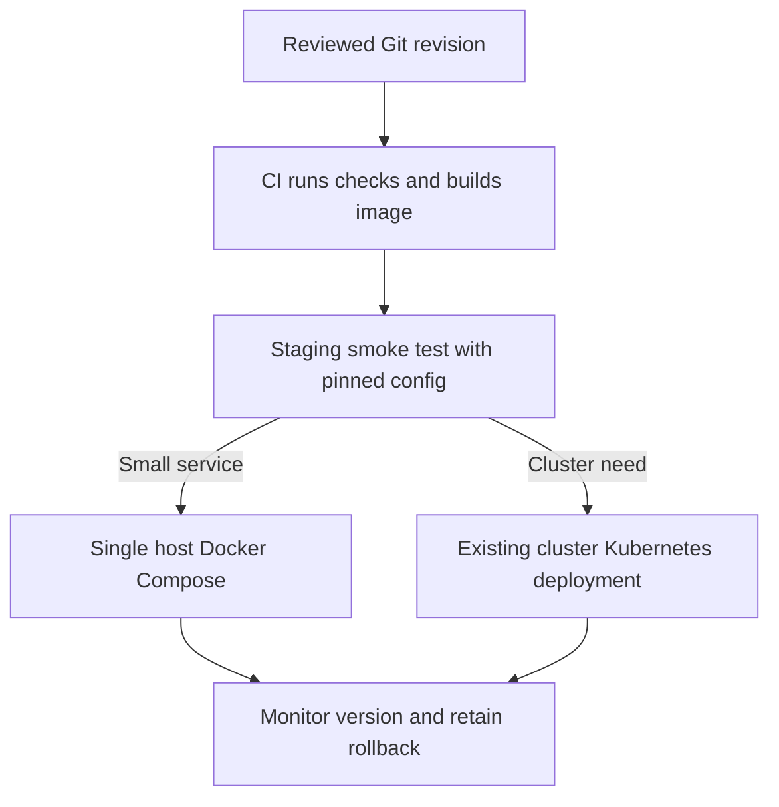


**Reading the flowchart**

A reviewed revision passes CI, becomes an immutable image and is checked in staging. The same tested image is promoted to the chosen environment. Runtime settings and credentials are supplied separately. A previous known-good image enables rollback.


**Why use this piece**

Use **Docker** to package the Python runtime and its dependencies. **Compose** can describe a small service and its supporting components on one host. Use **Kubernetes** when it is already your supported platform or requirements justify its operational cost. [ref 27][ref-27]


**When to use it**

Keep entry points, coordination and most tools on CPUs unless they run a model that needs a GPU. Put shared local inference on GPU-serving workers. Kubernetes GPU scheduling needs suitable drivers and device-plugin resources; apply resource requests and capacity controls based on measurements. An agent role does not inherently require its own GPU. [ref 28][ref-28]


**Alternatives:** a managed container service, an organization-supported VM deployment, or a serverless function for tasks whose duration and dependencies fit. Use GitHub Actions, GitLab CI or the internal CI system your organization can actually run.


**Starting choice:** a reproducible Python environment; Docker for deployment; use the existing hosting platform before adding a new one.

### 14 Identity policy and bounded execution

Used when accepting a task and before retrieval or tool execution.


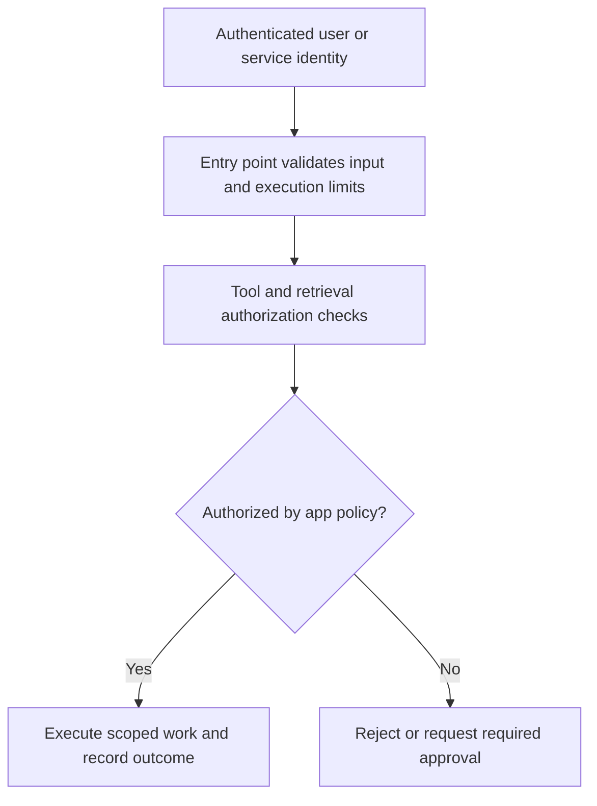


**Reading the flowchart**

The application knows which user or service is acting before calling the agent. It applies that identity again during retrieval and tool execution. Approval policies cover specific actions and record what was approved. For a local script, identity can come from its execution context; an existing application can pass its authenticated user context.


**Why use this piece**

Use the existing identity provider and secret manager. Inject identity and scoped service clients into the run. Enforce authorized document scope before returning retrieved context. Check tool arguments, output destinations and resource ownership in code. Treat retrieved text and tool output as data rather than instructions that can grant access.


**When to use it**

For a single-user local script, operating-system access may satisfy the immediate identity need. A shared service needs explicit user or service identity and per-operation policy. Bound runtime, input size, concurrency and model turns. Provider-side spending controls complement best-effort application usage estimates. [ref 10][ref-10]


**Alternatives:** operating-system identity for a local task, a worker service account with scoped access, or authenticated context supplied by an existing application. A larger policy engine is useful only when policy complexity and multiple services justify it. Pydantic validation helps with data shape; authorization needs its own checks.


**Starting choice:** existing identity and secrets services; scope checks at data and action boundaries.

### 15 Multiple agents and data workloads

Used only when distinct subtasks or resource-heavy computation improve a measured outcome.


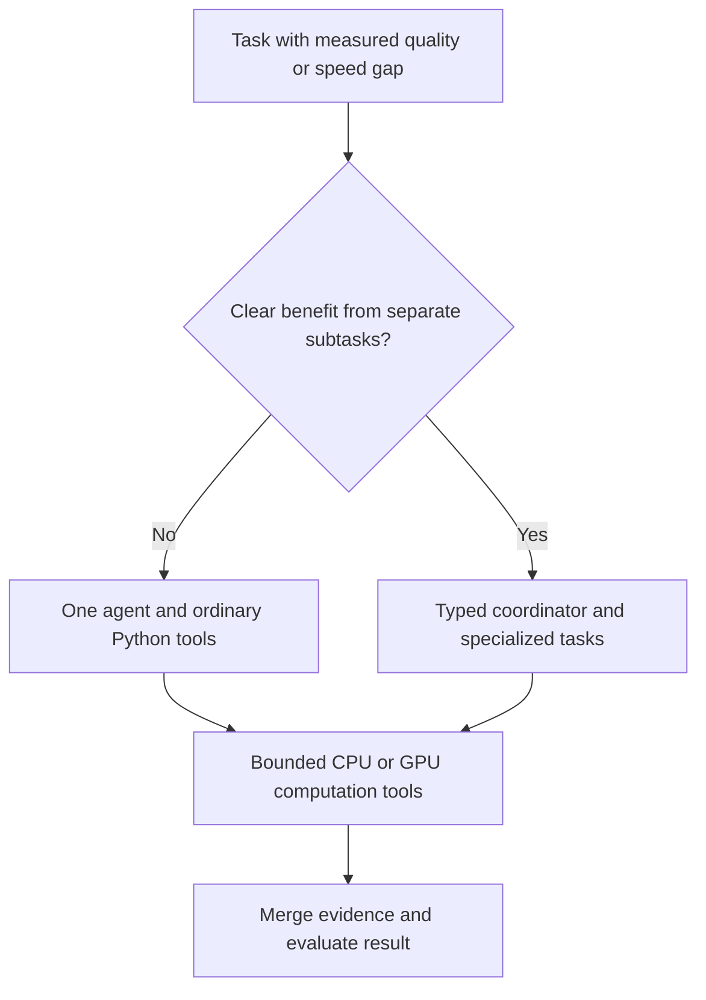


**Reading the flowchart**

Most tasks start with a single agent. If a measured limitation warrants decomposition, an application coordinator assigns scoped tasks with typed outputs. Ordinary compute tools perform data processing. The coordinator merges outputs and checks the combined result.


**Why use this piece**

Use separate agents for distinct context, tool permissions or independently useful deliverables. Keep data-intensive work in Python libraries and reproducible jobs. DuckDB and Parquet suit many local analytical scans; scientific or ML workloads can use the established numerical stack. Return bounded summaries and artifact references to the LLM.


**When to use it**

Add multiple agents after comparing them against a single-agent baseline. Measure final quality, latency, resource use and cost, including the merge step. If GPU capacity is limited, share inference servers and schedule expensive jobs; several CPU agents can call one model service.


**Alternatives:** ordinary Python functions or concurrent tasks for known independent computations; a typed graph for complex branching; LangGraph when graph-managed state is the dominant design. Adding multiple agent frameworks usually increases integration and debugging work, so give each a specific responsibility. [ref 29][ref-29]


**Starting choice:** one agent; explicit Python orchestration and bounded computation tools; specialize only when evaluation supports it.

## Build the stack in four stages

A working vertical slice comes first. Each later stage has a concrete reason to exist.


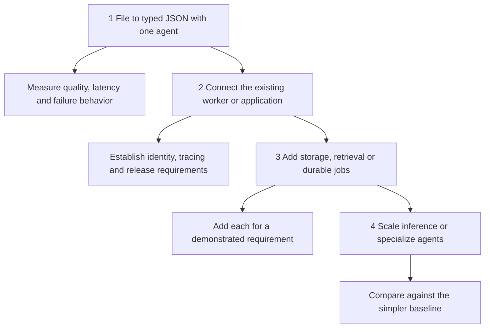


### Stage 1 A complete local task

Use Claude Code to create a small application with a clear input, a Pydantic output contract, one PydanticAI agent and one approved model. Save a validated JSON file. Add representative evaluation cases and explicit failure outcomes. Record versions and usage. This demonstrates the whole input-to-output path.

### Stage 2 Integration with the existing environment

Have the CLI, existing queue consumer, or existing application call the same Python workflow. Add Streamlit or an existing interface if people need upload, result inspection or correction. Integrate approved identity, secrets and tracing. Package a reproducible release and verify the normal path and expected failures in staging.

### Stage 3 Required persistence and recovery

Add shared storage when users need history or job ownership. Add retrieval when answers depend on searching a source collection. Add a worker or durable engine when jobs need recovery or long waits. Each component should satisfy a named requirement with an acceptance case.

### Stage 4 Measured scale and specialization

Load-test the intended task volume. Tune model choice, context size, concurrency and retrieval. Add shared GPU inference or separate agents only when measurements show a benefit. Keep a rollback path and reevaluate the complete task after each material change.

Before expanding, identify the current failure or bottleneck, name the component that addresses it, and state how you will measure improvement.

## Restricted networks and GPU placement

The Python runtime can stay internal. Claude Code needs its own supported route to Claude.


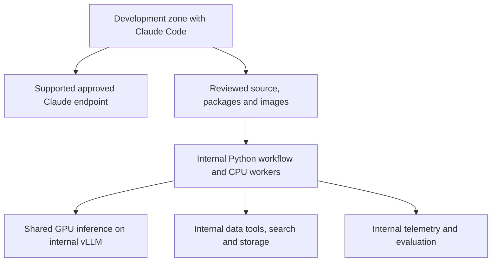


### Reading the flowchart

Development produces reviewed code and packaged dependencies. Those artifacts enter the internal environment through its approved process. Internal Python workers call internal inference and data services. Telemetry and evaluation can remain internal as well. The development assistant has its own model-connectivity requirement.

### Claude Code connectivity

Claude Code has supported enterprise provider and gateway paths. A gateway must satisfy Claude Code compatibility requirements; do not assume that an arbitrary local OpenAI-compatible model endpoint is a supported Claude Code backend. If the environment has no permitted Claude route, use Claude Code in a connected development zone on permitted material, then transfer reviewed artifacts through the approved process. A local-model coding tool is an alternative for work that must remain fully offline. [ref 30][ref-30], [ref 31][ref-31], [ref 32][ref-32]

### Internal application runtime

PydanticAI, the Python workflow, workers and evaluation code can run on internal hosts. Connect them to a documented internal model API and internal data services. A model-selection chat webpage alone does not supply the API contract. Pre-stage model weights, Python packages, container images and configuration; avoid runtime dependencies that fetch from the public internet. [ref 11][ref-11], [ref 12][ref-12]

### GPU capacity

Place coordination and most tools on CPUs. Put generation, embeddings or other accelerated workloads on GPU services as needed. If the earlier three-GPU-node ceiling applies here, budget those nodes as a shared pool and apply concurrency limits. Agents can share model servers; model size and workload determine whether serving needs one GPU or several. [ref 28][ref-28]

### Telemetry choice

Use an internal approved backend in this variant. Hosted Logfire and hosted gateways are optional architecture choices, rather than prerequisites for PydanticAI. [ref 11][ref-11], [ref 23][ref-23]

## Example request paths and ownership

| Task | Components exercised | Result and ownership |
| --- | --- | --- |
| Summarize one transcript | CLI or existing worker; Pydantic; PydanticAI; one model; checks; file output | Workflow owns splitting and synthesis when required. Save typed JSON with stable source references. Retrieval and a database may be unnecessary. |
| Answer questions over documents | Existing entry point and user context; authorized retriever; search index; PydanticAI; model; evidence checks | Retriever owns evidence selection. Agent drafts the answer. Application verifies cited document and passage identifiers. |
| Long research or analysis job | Existing job submitter; queue or durable engine; worker; PydanticAI; scoped tools; artifact store; telemetry | Execution service owns job status and recovery. Compute tools process large data. Return result and artifact references. |

### Keep responsibility explicit

| Component | Responsibility |
| --- | --- |
| Claude Code | Changes and checks the source code |
| CLI or existing integration | Accepts input and invokes the workflow |
| Python workflow | Owns known business order and final persistence |
| Pydantic | Defines and validates data contracts |
| PydanticAI | Coordinates each agent loop |
| Provider or inference service | Runs the model |
| Tool implementations | Perform scoped operations |
| Storage | Retains artifacts and required state |
| Durable engine, when adopted | Owns workflow recovery |
| Evaluation suite | Assesses software and AI behavior |
| Telemetry | Explains individual executions |

## Suggested code organization

Keep CLI, worker and optional UI adapters separate from the application workflow, agent definitions, schemas, prompts and tools. Put retrieval and durable-job integrations in their own modules when used. Keep unit tests and evaluation datasets separately runnable. This structure lets a local prototype connect to existing infrastructure without moving its core logic into an interface.

| Suggested path | Purpose |
| --- | --- |
| `main.py` | Local CLI entry point: read input, call the workflow, report the output path |
| `app/workflows/` | Known processing order, chunking, synthesis, verification and output persistence |
| `app/agents/` | PydanticAI agent definitions and agent configuration |
| `app/schemas.py` | Pydantic input, tool and output contracts |
| `app/prompts/` | Versioned task and synthesis instructions |
| `app/tools/` | Typed Python capabilities and external-service adapters |
| `app/entrypoints/` | Optional adapters for existing workers or applications |
| `app/retrieval/` | Optional ingestion and search logic |
| `app/jobs/` | Optional job and durable-execution integration |
| `tests/` | Deterministic application tests |
| `evals/` | Representative cases, evaluators and evaluation results |
| `CLAUDE.md` | Concise development context and exact project commands |
| `pyproject.toml` and `uv.lock` | Project settings, dependency declarations and reproducible dependency resolution |

These names describe a possible layout; an existing `worker.py`, provider adapter, or queue module can stay where it is and call the shared workflow. A model provider adapter and an application entry point have different responsibilities.

### What to choose first

For the Python tools you have been building, begin with the stage 1 file-to-JSON path. Preserve this separation so an internal model endpoint, background execution, retrieval and shared storage can be attached later without replacing the prompt and typed-output core.

## Official documentation

These are the primary sources retained from the guide, last checked on 25 October 2026. Reference numbers link to the relevant source below.


1. [Claude Code overview](https://code.claude.com/docs/en/overview)

2. [Claude Code extension choices](https://code.claude.com/docs/en/features-overview)

3. [Claude Code memory and project instructions](https://code.claude.com/docs/en/memory)

4. [Claude Code hooks and permissions](https://code.claude.com/docs/en/hooks)

5. [uv documentation](https://docs.astral.sh/uv/)

6. [Ruff documentation](https://docs.astral.sh/ruff/)

7. [pytest documentation](https://docs.pytest.org/en/stable/)

8. [Streamlit documentation](https://docs.streamlit.io/)

9. [Pydantic AI structured output](https://pydantic.dev/docs/ai/core-concepts/output/)

10. [Pydantic AI agents and usage limits](https://pydantic.dev/docs/ai/core-concepts/agent/)

11. [Pydantic AI production architecture](https://pydantic.dev/docs/ai/production/)

12. [Pydantic AI model and provider support](https://pydantic.dev/docs/ai/models/overview/)

13. [vLLM online model serving](https://docs.vllm.ai/en/latest/serving/online_serving/)

14. [HTTPX documentation](https://www.python-httpx.org/)

15. [Pydantic AI dependencies](https://pydantic.dev/docs/ai/core-concepts/dependencies/)

16. [Pydantic AI MCP client](https://pydantic.dev/docs/ai/mcp/client/)

17. [MCP architecture](https://modelcontextprotocol.io/docs/learn/architecture)

18. [pgvector project documentation](https://github.com/pgvector/pgvector)

19. [LlamaIndex framework documentation](https://developers.llamaindex.ai/python/framework/)

20. [Pydantic AI durable execution](https://pydantic.dev/docs/ai/capabilities/durable_execution/overview/)

21. [Pydantic AI Temporal integration](https://pydantic.dev/docs/ai/capabilities/durable_execution/temporal/)

22. [SQS repeated delivery and idempotency](https://docs.aws.amazon.com/AWSSimpleQueueService/latest/SQSDeveloperGuide/standard-queues-at-least-once-delivery.html)

23. [Pydantic AI observability](https://pydantic.dev/docs/ai/integrations/logfire/)

24. [OpenTelemetry overview](https://opentelemetry.io/docs/what-is-opentelemetry/)

25. [Pydantic Evals](https://pydantic.dev/docs/ai/evals/evals/)

26. [Pydantic AI unit testing](https://pydantic.dev/docs/ai/guides/testing/)

27. [Docker Compose application model](https://docs.docker.com/compose/intro/compose-application-model/)

28. [Kubernetes GPU scheduling](https://kubernetes.io/docs/tasks/manage-gpus/scheduling-gpus/)

29. [LangGraph overview](https://docs.langchain.com/oss/python/langgraph/overview)

30. [Claude Code enterprise deployment](https://code.claude.com/docs/en/third-party-integrations)

31. [Claude Code gateway compatibility](https://code.claude.com/docs/en/llm-gateway-protocol)

32. [Aider model connections](https://aider.chat/docs/llms.html)

33. [LiteLLM documentation](https://docs.litellm.ai/docs/)


[ref-1]: https://code.claude.com/docs/en/overview

[ref-2]: https://code.claude.com/docs/en/features-overview

[ref-3]: https://code.claude.com/docs/en/memory

[ref-4]: https://code.claude.com/docs/en/hooks

[ref-5]: https://docs.astral.sh/uv/

[ref-6]: https://docs.astral.sh/ruff/

[ref-7]: https://docs.pytest.org/en/stable/

[ref-8]: https://docs.streamlit.io/

[ref-9]: https://pydantic.dev/docs/ai/core-concepts/output/

[ref-10]: https://pydantic.dev/docs/ai/core-concepts/agent/

[ref-11]: https://pydantic.dev/docs/ai/production/

[ref-12]: https://pydantic.dev/docs/ai/models/overview/

[ref-13]: https://docs.vllm.ai/en/latest/serving/online_serving/

[ref-14]: https://www.python-httpx.org/

[ref-15]: https://pydantic.dev/docs/ai/core-concepts/dependencies/

[ref-16]: https://pydantic.dev/docs/ai/mcp/client/

[ref-17]: https://modelcontextprotocol.io/docs/learn/architecture

[ref-18]: https://github.com/pgvector/pgvector

[ref-19]: https://developers.llamaindex.ai/python/framework/

[ref-20]: https://pydantic.dev/docs/ai/capabilities/durable_execution/overview/

[ref-21]: https://pydantic.dev/docs/ai/capabilities/durable_execution/temporal/

[ref-22]: https://docs.aws.amazon.com/AWSSimpleQueueService/latest/SQSDeveloperGuide/standard-queues-at-least-once-delivery.html

[ref-23]: https://pydantic.dev/docs/ai/integrations/logfire/

[ref-24]: https://opentelemetry.io/docs/what-is-opentelemetry/

[ref-25]: https://pydantic.dev/docs/ai/evals/evals/

[ref-26]: https://pydantic.dev/docs/ai/guides/testing/

[ref-27]: https://docs.docker.com/compose/intro/compose-application-model/

[ref-28]: https://kubernetes.io/docs/tasks/manage-gpus/scheduling-gpus/

[ref-29]: https://docs.langchain.com/oss/python/langgraph/overview

[ref-30]: https://code.claude.com/docs/en/third-party-integrations

[ref-31]: https://code.claude.com/docs/en/llm-gateway-protocol

[ref-32]: https://aider.chat/docs/llms.html

[ref-33]: https://docs.litellm.ai/docs/
